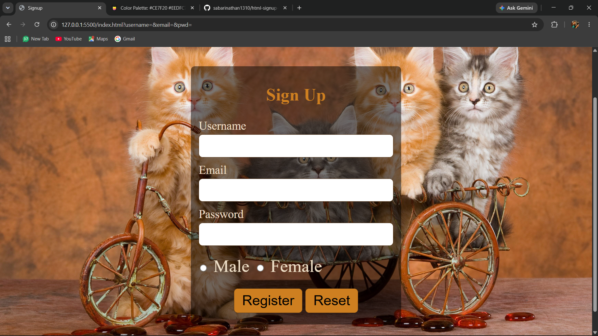

# Signup Page

A simple and responsive signup form built with HTML and CSS.

## Preview



## Features

- Username, email, and password fields
- Gender selection
- Register and reset buttons
- Transparent form container
- Custom background image
- Orange and dark-brown color theme

## Technologies Used

- HTML5
- CSS3

## Project Structure

```text
signup-page/
├── index.html
├── style.css
├── README.md
└── media/
    └── bg.jpg
```

## Getting Started

1. Clone or download this project.
2. Open `index.html` in your web browser.

No additional dependencies or installation steps are required.
